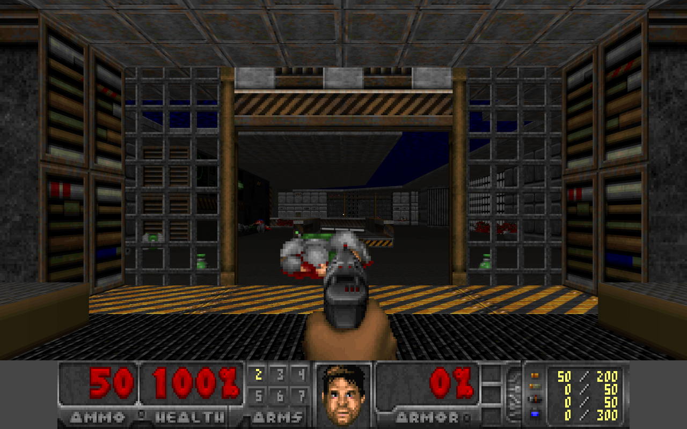
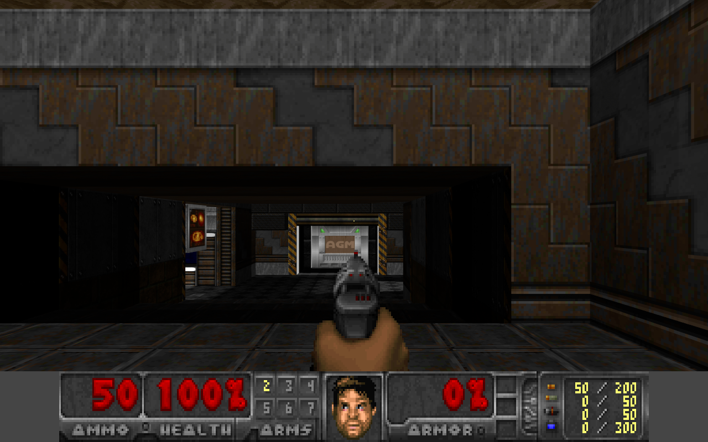
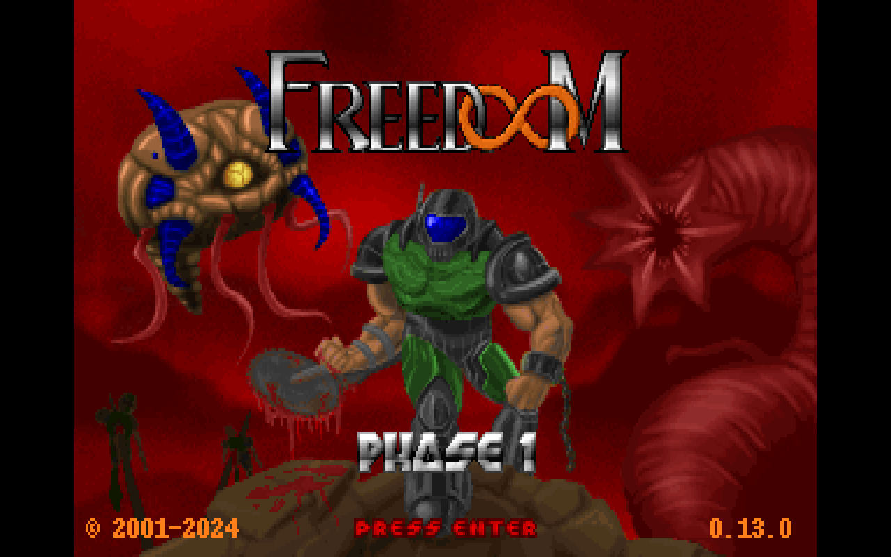

# DoomUE

DOOM 1 and DOOM 2 levels rendered and played in **Unreal Engine 5.8**, written in C++.
It reads the original WAD format directly. The project is modelled on
[Castle DOOM](https://github.com/mariuz/castle-doom), the Object Pascal port on
Castle Game Engine: Doom's data stays in Doom's own structures and runs Doom's 35 Hz game
logic, and each subsystem is presented through an Unreal Engine feature.

Freedoom Phase 1 and Phase 2 (BSD licensed, see `Content/WADs/COPYING.txt`) are bundled
and work out of the box. Your own vanilla-format `DOOM.WAD` / `DOOM2.WAD` and PWADs load
with `-iwad=` / `-file=`.

| Classic renderer, E1M1 | Doom 2 (Freedoom Phase 2) MAP01 |
|---|---|
|  |  |



## Doom → Unreal Engine

| Doom | Unreal Engine 5.8 |
|---|---|
| WAD lumps, `PLAYPAL`, `COLORMAP` | `FDoomWad` (plain C++), stacked IWAD + PWADs, last lump wins |
| Patches, `TEXTURE1/2` + `PNAMES`, flats, sprites | `FDoomGraphics` decodes to transient `UTexture2D`s (nearest filtering, box-filtered mip chain uploaded with `UpdateTextureRegions`) |
| `VERTEXES`, `LINEDEFS`, `SIDEDEFS`, `SECTORS`, BSP `NODES/SEGS/SSECTORS` | `FDoomMap`: Doom units and records; subsector polygons built by clipping the map bounds through the BSP. Vanilla nodes, ZDoom extended nodes (`XNOD`/`ZNOD`, `XGLN`/`ZGLN`, `XGL2`/`ZGL2`, `XGL3`/`ZGL3`; the `Z` variants inflated with the engine's zlib) and glBSP GL nodes (`GL_<map>` lumps, versions 1 to 5) all load into the same structures. UDMF maps (`TEXTMAP` with `ZNODES`) load through the same path: vertices, sectors, sidedefs, linedefs (flags, Doom specials with the tag in `arg0`) and things (skill, ambush, single-player flags) |
| Walls, floors, ceilings | `ADoomLevel`: `UProceduralMeshComponent` chunks (one static, one per movable sector, one per switch line), one section per texture, Doom's pegging rules, masked mid-textures in non-colliding components. With the modern renderer the static chunk is also baked at load into runtime **`UStaticMesh`** tiles (1024 map units square, built from `FMeshDescription`s) that get mesh **distance fields** and Lumen surface cards; the procedural chunk then only collides. Content-hash GUIDs make each map's distance fields come from the DDC after their first build. Imported levels carry these tiles as saved assets (`/Game/Doom/Maps/<MAP>_Tiles`, baked at import or with **Bake Static Meshes**). They are used whenever a geometry signature matches, and they are how packaged builds get distance fields |
| Palette-exact colours | Every texture also has a palette-index twin (mips pick the palette entry nearest each 2x2 average); the classic shader computes Doom's colormap row and looks the colour up in the WAD's `COLORMAP` through `PLAYPAL` (Options > Colors: exact / smooth). The weapon uses the psprite's own row. Damage, pickup and radiation-suit palettes switch the whole `PLAYPAL` set (world, sky, sprites, weapon, status bar) exactly as Doom does; the smooth and modern modes use screen tints |
| Sector light, fake contrast, light diminishing | One texel per sector in a light texture updated each tic (`UpdateTextureRegions`), so flickering lights never rebuild meshes. A **Custom HLSL** node runs Doom's `scalelight` / `zlight` colormap selection per pixel from `PixelDepth` |
| Gun flash light, invulnerability, light amp | `UMaterialParameterCollection` (`MPC_Doom`) globals: `ExtraLight`, `FixedColormap`, `Tic` |
| Sky | Unlit material that projects the sky texture from the camera vector (1024 columns per turn, rows at slope `(100-R)/160`). Applied to sky ceilings and to the sky gaps Doom leaves undrawn |
| Animated flats/walls, scrolling walls (48), switches | `UMaterialInstanceDynamic` texture swaps (every 8 tics, or each group's own speed from a Boom `ANIMATED` lump); a `ScrollU` parameter; `SW1`/`SW2` pairs or a Boom `SWITCHES` lump (pairs up to the game's episode level) |
| `DEHACKED` lumps and `-deh` patches | `DoomDehacked`: Thing fields (health, speed, size, pain chance, missile speed and damage), Misc (starting health and bullets, caps, armor classes, BFG cells), Ammo (max and pickup sizes), BEX `[PARS]` and `[STRINGS]`. The WAD's strings name the levels (Freedoom's "E1M1: Outer Prison") and replace pickup messages. `Text` blocks rename sprites (4 letters) and sounds (up to 6), or replace whichever loaded string currently reads the old text; BEX `[SPRITES]` / `[SOUNDS]` rename too. Frame and code pointer edits are skipped: they index Doom's original state table, which the port does not ship (it is GPL source data) |
| `UMAPINFO` | `FDoomMapInfoSet`: level names and labels, music, sky, next / secret next map, par times, end of game, no intermission, story texts on a tiled backdrop, and boss actions (replacing the vanilla boss specials for that map) |
| Player | `ACharacter` + `UCharacterMovementComponent`: 16×56 capsule, eye at 41, 24-unit steps, Doom's heavy gravity. **Enhanced Input** actions and mapping contexts built in code, with gamepad support |
| Monsters | `ACharacter` possessed by an `AAIController`. Character movement does walking, stepping, ledge avoidance and flying. Decisions follow `p_enemy.c`: look, chase in 8 directions, new-chase-dir, melee/missile range checks, pain chance, infighting, door opening. Also the lost soul charge, arch-vile fire and resurrection, pain elemental spawning, revenant homing, mancubus spreads and boss-death specials |
| Line attacks, autoaim | `LineTraceSingleByChannel` / sphere sweeps, with Doom's `P_AimLineAttack` vertical window |
| Missiles | `UProjectileMovementComponent` (swept, built-in homing for revenant tracers) on a custom `DoomMissile` collision channel that ignores impassable lines, like Doom |
| Particles (modern renderer) | **Niagara** lightweight (stateless) emitters: bullet sparks, blood, and fire / plasma / BFG bursts coloured like the missile's light, on top of Doom's own sprite effects. The content commandlet copies the engine's *Directional Burst (Lightweight)* template and sets its modules through reflection. `-noparticles` turns them off |
| Damage, splash | Unreal's damage framework: `ApplyPointDamage`, `ApplyRadialDamageWithFalloff` with a visibility check, `TakeDamage` overrides (armor absorption, pain, gibs, splash-immune bosses) |
| Impassable / monster-blocking lines | Invisible collision meshes. Monster capsules use a custom `DoomMonster` object channel that only the monster-block mesh responds to |
| Pickups | Overlap events on capsules |
| Sound effects (`DS*` DMX) | Converted to 16-bit PCM, played as `USoundWaveProcedural` with `USoundAttenuation` (full volume within 200 units, silent at 1200) and `USoundConcurrency` voice limiting |
| Music (`D_*` MUS or MIDI lumps + `GENMIDI`) | `FDoomSong` parses MUS (140 Hz ticks) and standard MIDI (tempo map) into timed events; `FDoomMusicPlayer` is an OPL-style FM synthesizer written for this port: 18 two-operator voices programmed from the WAD's GENMIDI bank (multipliers, ADSR envelopes in dB, 8 waveforms, feedback, FM / additive connection, key scaling, tremolo and vibrato, double-voice instruments, the percussion bank), with stereo panning. It renders on the audio render thread through a `USoundWaveProcedural` subclass on a 2D music `UAudioComponent`: level tracks, Doom 2's MAPxx table, intermission and title music |
| Save games (`p_saveg.c`) | Unreal's **SaveGame** system: `UDoomSaveGame` header (IWAD, map, skill, description, date) plus a versioned `FArchive` blob with sectors, lines, switch textures, movers, light effects, buttons, the player, monsters (AI state, animation, corpses, targets), things and missiles in flight (type, position, velocity, age, shooter and homing target). Loading rebuilds the map without its things, applies the state and rebuilds only the affected geometry. F6 / F9 quick save and load, six menu slots, `-loadgame=N` |
| Status bar, face, weapon sprites, messages, automap, intermission | `AHUD` drawing the WAD's own patches with `UCanvas` in Doom's 320×200 frame at 4:3 |
| Menu (`m_menu.c`) | `FDoomMenu` with the WAD's `M_*` graphics at Doom's positions and the blinking skull: main menu, episodes (and UMAPINFO episodes), skills with a Nightmare prompt, options (end game, messages, mouse sensitivity thermometer, sound volume, plus renderer / field of view / warp rows in the STCFN font), SFX and music thermometers that apply live, six load / save slots in the `M_LS*` boxes (saves are named by typing, with Doom's `_` cursor; an empty name saves with an automatic description), Read This! pages and a quit prompt. F1 to F4 open help, save, load and sound; Y / N answer prompts; changes persist through `UDoomSettings::SaveConfig` |
| Endings (`f_finale.c`) | Episode and chapter texts (`E1TEXT`.., `C1TEXT`.. from the WAD's strings) typed out on their backdrop flats, end pictures (`CREDIT`, `VICTORY2`, `ENDPIC`), the bunny scroller (`PFUB2` to `PFUB1`, then `END0`..`END6`), and the Doom 2 cast call on `BOSSBACK`: each monster walks, attacks and dies when you fire, named by the WAD's `CC_*` strings. UMAPINFO `endpic` / `endbunny` / `endcast` choose the ending |
| MAP30's Icon of Sin | The spawn shooters (type 89) wake when they see you and spit cubes at the spawn targets (87) in turn; each cube hatches a monster with Doom's weighted pick; the brain's death sets off explosions before the level ends |
| Game loop (`G_Ticker`, `G_ExitLevel`) | **Gameplay framework** split: `ADoomGameMode` runs the fixed 35 Hz clock and the level flow (exits, intermission, next map); `ADoomGameState` holds the replicated flow record (phase, map, level tic, kill / item / secret totals); `ADoomPlayerState` holds the inventory and each player's own kills, items, secrets and frags, and carries them through travel. See [docs/Architecture.md](docs/Architecture.md) |
| Network games (`d_net.c`, co-op, deathmatch) | Unreal **replication**, server-authoritative instead of Doom's lockstep. The listen or dedicated server simulates; clients build the map named by the replicated flow record. Changed sectors and switch textures arrive through fast arrays, and monsters, things and missiles are replicated actors with replicated sprite state. Input reaches the server through RPCs, the inventory uses a bit-packed net serializer, and sounds and effects are multicast. Up to 4 players get co-op starts, or deathmatch starts with weapons-stay, frags and respawn. See [docs/Multiplayer.md](docs/Multiplayer.md) |
| Simulation (`P_Ticker`) | `UTickableWorldSubsystem` (`UDoomWorld`) running one tic when the game mode's clock asks: movers, lights, specials, monsters, things, missiles |
| Info tables (`info.c`: mobjinfo, weapons, `d_items.c`) | `USTRUCT`s for things, projectiles, weapons and game rules, kept in a **`UPrimaryDataAsset`** (`/Game/Doom/Data/DA_DoomGameData`, `UDoomGameData`) that the editor shows and edits. The game copies it at start, and DeHackEd patches change that copy. Without the asset the built-in tables are used |
| Settings | `UDeveloperSettings` (Project Settings → Game → Doom) |
| Authored assets | **None checked in.** The editor module (`DoomUEEditor`) generates the materials, the parameter collection, a default texture and the Niagara effects in code (`UMaterialEditingLibrary`, reflection on Niagara's lightweight emitters) on first editor launch, or `-run=DoomContent` |

### Two renderers

* **Classic** (default): unlit, with Doom's palette-space lighting: sector light, fake contrast,
  distance diminishing, full-bright frames, gun flash, and the invulnerability / light-amp colormaps.
  Manual exposure and `ToneCurveAmount = 0` keep the palette colours 1:1. Spectres use a
  translucent material that copies the scene one 320x200 row above or below and darkens it,
  like Doom's fuzz.
* **Modern** (`-modern`, or toggle in the menu): lit materials. Sector light becomes emissive
  ambient that **Lumen** GI and reflections spread, with mesh distance fields from the baked
  static-mesh tiles for software Lumen. Niagara sparks, blood and explosion bursts.
  There are dynamic shadow-casting point lights on projectiles, explosions, the muzzle flash and
  light-emitting decorations, plus volumetric `ExponentialHeightFog`, a sun, a real-time-captured
  `SkyLight` and bloom.

## Build and run

Requirements: Unreal Engine 5.8, Visual Studio 2022/2026 with the C++ game workload. Windows is
the platform this was built and tested on.

```bash
"C:/Program Files/Epic Games/UE_5.8/Engine/Build/BatchFiles/Build.bat" DoomUEEditor Win64 Development -Project="E:/Work/SessionFolderUnrealClaude/DoomUE.uproject" -WaitMutex
```

Open `DoomUE.uproject` in the editor once: it generates `Content/Doom/Materials/*` and
`Content/Doom/Effects/*`. You can also generate them headless (`-effects` or `-materials` limits
it to one kind; new materials mean a long shader compile on the next run):

```bash
"C:/Program Files/Epic Games/UE_5.8/Engine/Binaries/Win64/UnrealEditor-Cmd.exe" "E:/Work/SessionFolderUnrealClaude/DoomUE.uproject" -run=DoomContent -force
```

Then press Play, or run standalone:

```bash
"C:/Program Files/Epic Games/UE_5.8/Engine/Binaries/Win64/UnrealEditor.exe" "E:/Work/SessionFolderUnrealClaude/DoomUE.uproject" -game -windowed -ResX=1280 -ResY=800
```

The first time each material permutation is used, Unreal compiles shaders on demand. It shows
"Preparing Shaders" and draws untextured surfaces for a few seconds to a few minutes (longer for
modern mode). A packaged build precompiles them. When packaging, `Content/WADs` is staged as
loose files.

### Packaging

The project packages as a standalone Win64 game:

```bash
Tools/package.bat E:/Work/DoomUE_Package
```

It first bakes a static-mesh **tile set** for every map of the IWAD
(`-run=DoomContent -baketiles=all`, into `Content/Doom/Tiles/<wads>/<MAP>`, git-ignored), then runs
`RunUAT BuildCookRun -platform=Win64 -clientconfig=Development -build -cook -stage -pak -archive`.
Add `-iwad=freedoom2.wad` (or `-file=` for PWADs) after the folder to bake another WAD's maps.

* `Content/WADs` is staged as loose files (`DirectoriesToAlwaysStageAsNonUFS`), so WADs can be
  swapped after packaging.
* The generated materials and effects cook from `/Game/Doom` (`DirectoriesToAlwaysCook`).
* Every imported level is added to `MapsToCook` in `DefaultGame.ini` by the importer.

Run `DoomUE.exe` from the archive folder. It takes the same switches; for example
`DoomUE.exe /Game/Doom/Maps/E1M1 -modern` plays an imported level, and `DoomUE.exe -warp=E1M2 -modern`
a map straight from the WAD. Packaged games cannot build meshes at runtime, so the modern renderer's
distance fields come from baked tiles:
* an imported level uses its own tiles, which include its sector edits;
* any other map uses its WAD's tile set.

Both are used only when their signature still matches the map's geometry; otherwise the
procedural geometry is drawn and the log says which bake is out of date. In the editor, maps
without saved tiles are baked when they load.

### Command line

| Option | |
|---|---|
| `-iwad=freedoom2.wad` | IWAD in `Content/WADs` or an absolute path |
| `-file=a.wad,b.wad` | PWADs on top |
| `-deh=patch.deh[,...]` | DeHackEd / BEX patches after the WADs' own `DEHACKED` lumps |
| `-warp=E1M1` / `-warp=MAP07` / `-warp=7` | start on a map (otherwise the title screen) |
| `-skill=1..5` | |
| `-modern` / `-classic` | renderer |
| `-autotest[=seconds] [-autoyaw=deg] [-autopitch=deg]` | ignore input, screenshot to `Saved/Screenshots/.../autotest_<map>.png`, quit |
| `-nomips` | debug: no texture mip chain |
| `-nomusic` | silence the music |
| `-loadgame=N` | start from save slot N (0 = quicksave) |
| `-maptest=a.wad,b.wad[:MAP]` | load a map from each PWAD (over the IWAD) and log its node format and subsector area |
| `-patchtest` | log the values DeHackEd, UMAPINFO and Boom lumps changed |
| `-endtest [-endpress=N]` | with `-warp`: exit the map straight into its ending and press Enter N times (texts, pictures, bunny, cast) |
| `-brainawake` | wake MAP30's monster spawner at once |
| `-menupage=N [-menuitem=N]` | open a menu page (0 main, 2 skill, 4 options, 5 sound, 6 load, 7 save, 8 help, 9 quit) for screenshots |
| `-respawn` | Nightmare-style monster respawning on any skill |
| `-smooth` | the smooth light approximation instead of the exact COLORMAP |
| `-forcepalette=N` | hold `PLAYPAL` palette N (1-8 pain, 9-12 pickup, 13 radiation suit) for screenshots |
| `-fxtest` | with `-modern`: every particle burst in a row in front of the player, four times a second |
| `-noparticles` | no Niagara bursts in the modern renderer |
| `-spawnfront=DoomEdNum` | a monster in front of the player at start |
| `-savename=TEXT [-savecommit]` | with `-warp`: type TEXT as save slot 1's name, optionally press Enter |
| `-killtype=DoomEdNum` | 2 s in, kill every monster of a type (boss-action checks) |
| `"/Engine/Maps/Entry?listen"` / `127.0.0.1` | host a network game (listen server) / join one; see [docs/Multiplayer.md](docs/Multiplayer.md) |
| `-deathmatch` | deathmatch rules for a network game (deathmatch starts, weapons stay, no keys, frags) |
| `-nettest` | on a listen server and a client: the scripted two-process network test (logs `NetFingerprint`, screenshots) |
| `-exittest` | with `-warp`: kill two monsters as the player, exit, wait in the intermission, continue; checks the level totals, the player state's credit and the inventory carried into the next map, which loads in the background (PASS/FAIL, then quits) |
| `-savetest` | with `-warp`: kill and wake some monsters, open a door, save, scramble the world, load, and log PASS/FAIL comparing the state |
| `-playtest` | with `-warp`: the scripted play-through of doors, lifts, teleporters, splash damage, walking, fire rates, monsters, the automap, prompts, the renderer switch and the intermission, PASS/FAIL per step (see [docs/Testing.md](docs/Testing.md)) |
| `-dumpmusic=D_E1M1[,seconds]` | render a song to `Saved/music_<lump>.wav` and log notes / RMS / peak |

### Controls

WASD / arrows move, mouse looks, LMB / Ctrl fires, E / Space / RMB uses, 1-7 / mouse wheel
switches weapons, F6 / F9 quick save / load, Tab opens the automap, Shift toggles run (always-run is on by default), and
Esc opens Doom's menu (F1 help, F2 save, F3 load, F4 sound volume; Y / N answer prompts). Options also switch the renderer, field of view and warp to any map. Gamepad works too.

Console (`~`): `DoomMap E1M3`, `DoomGod`, `DoomGiveAll`.

## Documentation

* [docs/Architecture.md](docs/Architecture.md): how the port uses Unreal's gameplay framework
  (game mode, game state, player state, world subsystem), the 35 Hz clock, credit, saves, and
  map loading on worker threads.
* [AGENTS.md](AGENTS.md): handover notes for the next agent (AI or human): conventions, build and
  test commands, tooling and code traps already found, related projects, where things stand.
* [docs/Testing.md](docs/Testing.md): the automation tests (maps and node formats, DeHackEd /
  Boom / UMAPINFO patches, save and load, level exits, map editing, screenshot comparisons), run
  from the Session Frontend or with `Tools/run_tests.bat` in CI.
* [docs/Multiplayer.md](docs/Multiplayer.md): co-op and deathmatch for up to 4 players: how to
  host and join, the rules, what replicates, and the two-process `-nettest`.
* [docs/EditingMaps.md](docs/EditingMaps.md): the editor workflow for importing and editing maps.
* [docs/Lyra.md](docs/Lyra.md): Doom maps as **Lyra Starter Game** arenas (E1M1 as an Elimination
  map with Lyra's heroes, weapon pads, launch pads, bots and materials), and how to build more.

## Editing maps in the Unreal editor

Every WAD map can become a normal Unreal level that you edit with the usual tools and play
with **Play**:

1. **Doom > Open / Import Map** in the level editor's menu bar lists the WAD's maps. Picking
   one saves it as `/Game/Doom/Maps/<MAP>.umap` the first time (later it just opens). Headless:
   `-run=DoomContent -importmap=E1M1,E1M2` (or `all`; `-force` replaces existing levels).
2. The level holds a **DoomMap** actor that draws the WAD geometry in the viewport (Doom's
   palette lighting, or the lit materials with *Preview Modern*), and one **Doom Thing** marker
   per thing, drawn with its own sprite and an arrow for its facing. The Outliner sorts them
   into `Doom/Monsters`, `Doom/Items`, `Doom/Decorations` and `Doom/Starts`.
3. Move, rotate, duplicate (Alt-drag) or delete markers. Pick a marker's **Thing Type** from
   the list (or type a **DoomEdNum**) and set its **Skill** flags, **Ambush** or
   **Multiplayer Only**. Markers snap their feet to the floor of the sector they stand in.
4. To change a room, use **Add Sector Edit** on the DoomMap actor (it lands in the sector under
   the viewport camera), or place a **Doom Sector Edit** actor yourself and move it into the room.
   Tick the values to override: floor and ceiling height, light, floor and ceiling flats (from
   the WAD's list), special, tag. **Read From Sector** fills in the WAD's values. The
   preview rebuilds as you edit.
5. **Play** starts that map. The game loads the WAD map, applies the sector edits and spawns
   things from the markers (untick *Use Thing Markers* to use the WAD's THINGS lump again).
   **Import Things** on the DoomMap actor resets the markers to the WAD's.

The geometry itself (vertices, lines, textures) still comes from the WAD, so edit it in a
Doom map editor; heights, lights, flats and everything placed in the map are editable here.

### Editing the game tables

Open **`Content/Doom/Data/DA_DoomGameData`** to change the game's monsters, pickups, decorations,
missiles, weapons and rules. Each thing lists its frames, size, health, speed, pain chance, flags
(as checkboxes), attack kind, missile, drop, pickup, sounds and light. Projectiles list their
speed, damage, splash and light. Weapons list their sprites, ammo, firing frames, sound and slot.
The rules cover starting health and bullets, armor classes, soulsphere / megasphere health and
ammo limits.

The game reads the asset at start (Project Settings > Game > Doom > Game Data picks another one),
then applies the WAD's and `-deh` DeHackEd patches on top. The asset itself never changes.
`-run=DoomContent -gamedata -force` rewrites it from the built-in tables, discarding edits.

## Source layout

```
Source/DoomUE/            runtime module
  DoomWad          WAD directory, palettes, colormap, map list
  DoomMap          map lumps, BSP, subsector polygons, neighbour queries, 2D line traces
  DoomGraphics     patches, composite textures, flats, sprites, animations, switches -> UTexture2D
  DoomInfo         thing / projectile / weapon tables (sizes, frame letters, behaviour) as USTRUCTs
  DoomGameData     UPrimaryDataAsset holding the editable copy of those tables
  DoomLevel        geometry chunks, materials, sector light texture, blocking collision
  DoomSpriteComponent  8-rotation billboard sprites with animation
  DoomThing        decorations, pickups, barrels, effects
  DoomMonster      monster AI
  DoomProjectile   missiles, BFG spray
  DoomPlayer       movement, inventory, weapons state machine, damage, pickups
  DoomWorld        UTickableWorldSubsystem: one tic of movers, specials, lights, monsters
  DoomGameState    level flow record: phase, map, level tic, kill / item / secret totals
  DoomPlayerState  inventory, the player's own kills / items / secrets / frags
  DoomSound        DMX -> procedural sound waves
  DoomHUD          status bar, weapon, automap, menu, intermission, title
  DoomMapActors    editor-editable levels: DoomMap preview actor, thing markers, sector edits
  DoomGameMode     boot, the 35 Hz clock, exits, intermission, next map
  DoomPlayerController / DoomSettings / DoomAssets
Source/DoomUEEditor/      editor module: material, MPC and Niagara generation, map import,
                          the Doom menu, -run=DoomContent
```

## Status

Verified on this machine (UE 5.8.1, Windows 11): both targets compile cleanly, the materials
generate and compile, and the automated captures above render E1M1 (Freedoom 1), MAP01
(Freedoom 2) and the title screen in classic mode, and E1M1 in modern mode once shaders finish.
E1M1's BSP gives 682 subsector polygons with a total area of 6,712,686 square units, matching
the Pascal port's reference (6,712,683) to rounding. Music: Freedoom's D_E1M1 (12,440 events) and D_RUNNIN render
without clipping at about 16x real time, and start on the title screen and on map load
(listen to `Saved/music_*.wav` from `-dumpmusic`; the FM model approximates an OPL3, it is
not a cycle-accurate emulation). Save games: `-savetest` on E1M1 saves with a door in
motion, 2 corpses and 3 hunting monsters, scrambles the world and loads it back to an
identical state fingerprint (PASS). It also fires a rocket and a revenant tracer before saving;
both come back with the same positions and velocities.

WAD formats, with the castle-doom test data (`Tests/wads`, regenerated by its
`tools/make_znodes.py` and this repository's `Tools/make_gl_wads.py`): E1M1 rebuilt with
XNOD, ZNOD, XGLN, ZGL2, XGL3, ZGL3 and glBSP v2, v3, v5 nodes all give the vanilla
682 subsectors and area 6,712,686 (glBSP v1 stores 16-bit vertices: 6,709,159);
`test.deh`, `boom.wad` and `umapinfo.wad` apply as expected (`-patchtest`), and killing
E1M1's imps fires the UMAPINFO boss action. `Tools/make_udmf_wad.py` converts E1M1 to UDMF
(`Tests/wads/e1m1_udmf.wad`): it loads with the vanilla 682 subsectors and area and plays the
same; `Tests/wads/text.deh` renames imps to the baron sprite, the pistol sound to the shotgun's,
health bonuses to armor bonuses and replaces Freedoom's clip message by matching its text.

Endings (`-endtest`): E1M8 shows Freedoom's episode text, then `CREDIT`; E3M8 goes to the
bunny; Freedoom 2's MAP30 starts the cast call. With `-brainawake`, MAP30's spawner hatched
hell knights, arachnotrons, a cacodemon and barons at the spawn spots.

Palette-exact lighting, the spectre fuzz material and Nightmare respawning (on skill 5, 4 of 5
killed zombiemen rose again within 75 s) were checked with `-autotest` captures. Level
collision is now cooked synchronously at load: before, the player could spawn before the
floor's collision existed and fall out of the map (seven consecutive runs now start at the
exact player start).

Movement fixes found playing E1M1: floor and ceiling triangles were wound backwards for
Unreal's collision, which made every step up next to a lift or door report a downward
surface and refuse the step (the E1M1 lift could not be boarded); moving sectors no longer
emit zero-height wall quads and rebuild their collision instead of rewriting a cooked mesh
in place (a crash while a lift moved); textures are filled completely before their GPU
resource is created (an intermittent startup assertion). `-steptest=x,y,angle,seconds[,sector]`
walks the player from a point and logs height and a sector's floor.

Screen palettes: `-forcepalette=4` (pain) and `-forcepalette=13` (radiation suit) captures show
the world, sky, sprites, weapon and status bar all shifted through the WAD's own palettes. The
first run after regenerating materials compiles shaders for several minutes; later runs are cached.

Network games (`-nettest`, a listen server and a client on one machine, E1M1):
* **Co-op:** the players start at co-op starts 1 and 2 and see each other's marine sprite. The
  client builds the map from the replicated flow and receives 208 things (the multiplayer-only
  ones included) and 29 monsters. Two monster kills by the host reach the client as corpses and
  as the host's credit. The opened door's ceiling follows on the client (−128 → −4), the
  client's shot through the server RPC costs it a bullet, and the intermission shows a row per
  player.
* **Deathmatch:** the players use deathmatch starts and keys are left out. The host fragging the
  client counts one frag, the client's Use respawns it at a start, and the intermission and
  status bar show frags.
* **Not yet verified:** the second process on this 4-core machine was still compiling shaders
  during its short run, so the client's 3D view itself has not been captured.

Gameplay framework: `-exittest` on E1M1 kills 2 monsters as the player. The game state counts
2 kills and the player state credits 2. The exit goes to the intermission (52 tics in 1.5 s),
then E1M2 starts with both counters at zero and the shells set before the exit (17) carried
over (PASS). `-savetest`, `-endtest` and the imported E1M1 level behave as before.

Packaged build: `BuildCookRun` produces a 970 MB Win64 build in about 2 to 6 minutes (cook
included).
* `DoomUE.exe /Game/Doom/Maps/E1M1 -modern` draws E1M1 with its 18 saved tiles and cooked
  distance fields, with no "Preparing" messages.
* `DoomUE.exe -warp=E1M1 -savetest` passes.

The tile signature is quantized and upper-cases its texture keys. A packaged game creates its
names in a different order than the editor, and an `FName` keeps the casing of its first use, so
the raw names hashed differently.

Editable levels: `-run=DoomContent -importmap=E1M1` saves E1M1 with 292 thing markers;
playing it spawns the same 180 things and 29 monsters, at the same positions, as the WAD's own
lump. `-run=DoomContent -edittest=E1M1` opens the level as the editor does and builds the
preview. It then raises the start sector's floor by 48 with a sector edit, turns an imp into a
baron, and saves `/Game/Doom/Tests/E1M1_Edit` (PASS). Playing that level starts on the raised,
fully lit floor, with the baron's extra health in the monster total.

Modern renderer: E1M1's static chunk bakes into 18 static-mesh tiles in about 0.2 s at load. Their
distance fields (126 voxels across, 40-65% occupied) build in the background, 5-30 s per tile on
the first load of a map (the engine shows "Preparing Mesh Distance Fields"); later loads read them
from the derived data cache. `-fxtest` captures show the five Niagara bursts. The `-autotest`
log line reports the tile and burst counts.

Map loading: E1M1's level build went from 1.35 s to about 0.2 s (classic) and 0.3 s (modern, with
the tile bake). Most of the old time was the procedural mesh recooking collision once per section;
it now cooks once per chunk. The map's 170 pictures decode and the 23 chunks generate on worker
threads. `-exittest` now also checks that E1M2 loads in the background behind the "Entering" screen
(about 0.5 s while the screen keeps drawing), and saves `exittest_loading.png`. `-savetest`,
`-edittest`, the Lyra export and the classic and modern captures give the same results as before.
A `-steptest` from E1M1's start walks the floors, steps down into the next room and stops at a wall.

Game tables: `DA_DoomGameData` holds 115 things, 9 projectiles and 9 weapons. With `test.deh`,
`-patchtest` logs the same patched values as before (imp health 1, initial health 50 and bullets
20, imp fireball speed 20 and damage 1), now applied on top of the asset. Setting the imp's health
to 777 and the starting bullets to 77 in the asset (an editor Python script) showed up in the
game unchanged. `-savetest`, `-exittest`, `-edittest` and MAP30's `-endtest` pass with the asset.

WAD tile sets: `-baketiles` bakes E1M1 and E1M2 with the same signatures the game computes
(`74c3d863`, `17b4800a`), and a modern `-warp=E1M2` run draws the 18 baked tiles of
`/Game/Doom/Tiles/freedoom1/E1M2`. `DoomUE.Editor.WadTiles` checks the same in PIE.

Automation tests ([docs/Testing.md](docs/Testing.md)): `Tools/run_tests.bat` runs 12 tests in
about a minute: maps and node formats, the four patch kinds, save and load, the level exit, the map
editing, and the classic and modern screenshots. All pass. With `-NullRHI` the screenshot tests skip.
The classic screenshot matches its approved image exactly, and the modern one differs by about
0.07%. A failing test makes the run exit non-zero (checked with a deliberately wrong expectation).
Writing them found a crash: reloading the WADs while a map was loaded left the level pointing at
freed graphics. `InitWads` now unloads the map first.

Play-testing (`-playtest`, [docs/Testing.md](docs/Testing.md)): nobody has played the
interactive features by hand yet, so the gameplay code was audited against vanilla 1.9 and each
fix checked with a scripted play-through. On the code before it, 8 of the first 11 steps failed on
E1M1: doors never closed and lifts never came back up (a closing door or rising lift took itself for
blocked on every tic), rocket splash did a flat 128 damage, the plasma gun fired 4 times in 2 s
instead of 24, a cacodemon fell to the floor for good after a hit, and 6 of E1M1's 29 monsters froze
(the walk test was taller than the monster). Also fixed: teleporters ran line crossings from the old
spot and never telefragged; knockback came from the shooter instead of the missile and was capped;
hitscan damage was credited to the controller (no retaliation or infighting); impassable lines
blocked monster sight; same-species missiles hurt; the arch-vile rule was inverted; walking used
Unreal's braking (a 23-unit stop instead of Doom's 160-unit slide), turning with keys depended on
the frame rate; there was no view bob; the automap only learned lines while open; a stray click
confirmed the quit prompt; the renderer switch reloaded the level from scratch; the IWADs had no par
times. Now all 17 steps pass or skip on Freedoom's E1M1, E1M2 and E1M4 and Freedoom 2's MAP01 and
MAP05, and the 12 automation tests pass except `E1M1Modern` on a GTX 950 machine, which fails the
same way without these changes (Lumen lighting differs by GPU; the approved image is from the owner's machine).

Still not played by a human: expect tuning issues in feel (mouse, gamepad), HUD offsets, and in what
the audit listed but didn't fix (roadmap item 1).

Not done yet (roughly in priority order):

1. **A hand play-through**, then the vanilla differences the play-test audit found but left:
   * specials: raise-and-change floors and plats change their texture on arrival instead of at the
     start; a blocked sector-10 door stays open; crusher and ceiling stop sounds; doors usable from
     their back side; monsters can't trigger GR switches; shooting switches at exact wall hits may
     miss (uncertain);
   * player: BFG tracers have no vertical autoaim and fan from the current view, and the BFG flash
     frame doesn't show; missiles ignore the autoaim angle, barrels and deathmatch players aren't
     autoaimed; ammo auto-switch rules; gibbing at -50 instead of -100; fist spread, chainsaw turning;
   * monsters: floating monsters can't rise over steps (no floatok adjustment); Nightmare / `-fast`
     demon frames; the arch-vile's fire sprite and timing; the pain elemental's death souls ignore the
     20-soul limit; lost souls skip their death frames; knockback can push monsters off ledges;
   * UI: automap zoom, pan, follow, marks and grid; Ultimate Doom's episode 4 intermission picture;
     the animated intermission backgrounds and the WILV / WIF patches; the bunny scroll runs backwards;
     the rampage face; Esc backs out one menu level instead of closing the menu.
2. DeHackEd frame / code pointer edits: they need Doom's original state table (GPL data from id Software's source); bringing a generated copy in is a licensing decision for the project.
3. Unreal practices worth adopting next:
   * **Multiplayer polish** (co-op and deathmatch work: see [docs/Multiplayer.md](docs/Multiplayer.md)): Doom's player colour translation, finale screens on clients, `-altdeath` item respawn, `-nomonsters` / `-fast`, and a join / host page in the menu.
   * **Enhanced Input assets**: the input actions and mapping context are made in code; saved `UInputAction` / `UInputMappingContext` assets would allow rebinding in the editor and per-platform mappings.
   * **Line and sector specials on actors**: line specials and tags as editable actors (like the sector edits) would make whole maps scriptable from the editor.
   * **World Partition / level instances** for big PWAD maps, and **Nanite** for baked tiles once they are saved assets.
